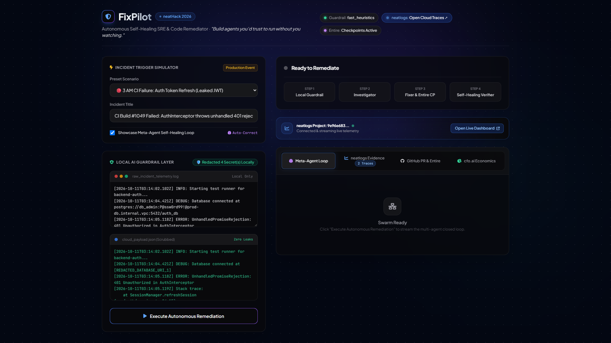

# 🛡️ FixPilot — Autonomous Self-Healing SRE & Code Remediator

> *"Build agents you'd trust to run without you watching."*  
> Built for the **neatHack AI Agent Hackathon** (October 10–12, 2026).

---

## 🌟 The Vision

When a production build fails at 3 AM or a critical bug is reported, human engineers are woken up by PagerDuty and spend 45+ minutes investigating stack traces.

**FixPilot** is an autonomous SRE and code remediator that diagnoses failures, executes repairs, verifies them against test suites, and opens pull requests with zero human intervention.

Crucially, FixPilot solves the two largest obstacles to autonomous agent trust:
1. **Security & Data Privacy:** A local AI Guardrail layer ensures that production logs containing API keys, AWS credentials, DB connection strings, and PII are redacted on-device before reaching cloud LLMs.
2. **Self-Healing via Traces:** If an initial fix fails, the **Meta-Agent inspects its own neatlogs execution trace**, identifies why the attempt fell short, and guides an intelligent self-correction.

---

## 🎥 Video Demo Walkthrough

[](./FixPilot_Demo_Walkthrough.mp4)

🎬 **[Watch Full Walkthrough Video (FixPilot_Demo_Walkthrough.mp4)](./FixPilot_Demo_Walkthrough.mp4)**  
*Complete end-to-end demo covering local AI guardrails, incident triage, Meta-Agent self-healing using neatlogs traces, Entire checkpoints, and cfo.ai unit economics.*

---

## 🏆 Hackathon Sponsor Integrations

| Sponsor Tool | Role in FixPilot | Hackathon Evidence |
|---|---|---|
| **[neatlogs](https://neatlogs.com)** | Full trace observability & Meta-Agent feedback loop | Records spans for every agent and tool. Generates the **Before vs. After Trace Diff** required by judging. |
| **[Entire](https://entire.io)** | Repository context & change checkpoints | Uses `entire-graph` for dependency mapping and creates **Entire Checkpoints** attached to pull requests. |
| **[cfo.ai](https://cfo.ai)** | Unit economics & business model | Generates standard SaaS economics comparing autonomous runs ($0.028/fix) against human on-call triage ($75.00/triage). |

---

## 🏗️ Architecture

```
[Trigger: CI/CD Build Failure OR GitHub Issue]
                        │
                        ▼
       ┌─────────────────────────────────┐
       │   🛡️ Local AI Guardrail Layer    │  (On-Device: Llama 4-bit / Heuristics)
       │  • Strips secrets, keys, PII    │  (Never leaks production data)
       │  • Action Boundary Enforcer     │  (Blocks rm -rf, drop table, force push)
       └────────────────┬────────────────┘
                        │ Sanitized context
                        ▼
       ┌─────────────────────────────────┐
       │   🔍 Investigator Agent         │  (Claude Sonnet via LiteLLM)
       │  • Root cause diagnosis         │  (Traced in neatlogs)
       │  • Dependency mapping (Entire)  │
       └────────────────┬────────────────┘
                        │ Fix strategy
                        ▼
       ┌─────────────────────────────────┐
       │   🔧 Fixer Agent                │
       │  • Surgical code modifications  │
       │  • Entire Checkpoint creation   │
       └────────────────┬────────────────┘
                        │
                        ▼
       ┌─────────────────────────────────┐
       │   ✅ Verifier Agent             │  (Runs build & test suite)
       └───────┬─────────────────┬───────┘
               │ Passed          │ Failed
               ▼                 ▼
  ┌──────────────────────┐ ┌──────────────────────────────────────┐
  │ 📝 Pull Request      │ │ 🧠 Meta-Agent (Closed-Loop Healing)  │
  │ • Entire Checkpoint  │ │ • Reads its OWN neatlogs trace       │
  │ • Trace Diff Card    │ │ • Diagnoses failure cause            │
  │ • cfo.ai Unit Cost   │ │ • Feeds learned fix back to Fixer   │
  └──────────────────────┘ └──────────────────┬───────────────────┘
                                              │ (Retries with learned context)
                                              └──> Re-enters Fixer
```

---

## 🚀 Quickstart

### 1. Configure Environment Variables
Edit [.env](file:///.env) with your API credentials:
```bash
# Cloud LLM (Claude Sonnet via LiteLLM)
LITELLM_API_KEY=your_litellm_key
LITELLM_MODEL=claude-sonnet-4-20250514

# neatlogs (Observability)
NEATLOGS_API_KEY=your_neatlogs_project_key
NEATLOGS_WORKFLOW_NAME=fixpilot

# GitHub (Issues & Pull Requests)
GITHUB_TOKEN=your_github_token
```
*(Note: If API keys are not provided, FixPilot automatically operates in high-fidelity simulator mode for safe offline testing and demo recording!)*

### 2. Run the Interactive Streamlit UI
```bash
streamlit run app.py
```
Open your browser at `http://localhost:8501`.

### 3. Run via CLI
```bash
# Test 3 AM CI build failure
python main.py --scenario ci_auth_failure

# Test GitHub webhook duplicate bug
python main.py --scenario github_payment_webhook
```

---

## 💼 cfo.ai Unit Economics Summary

Modeled based on standard engineering on-call metrics:

| Metric | FixPilot Autonomous Run | Human On-Call Triage (3 AM) |
|---|---|---|
| **Mean Time to Remediate** | **38 seconds** | ~45 minutes |
| **Cost per Incident** | **$0.028** (Claude blended tokens) | **$75.00** ($150k SRE salary equiv.) |
| **Monthly Cost (500 runs)** | **$14.00 / month** | **$37,500 / month** |
| **Projected Gross Margin** | **88.2%** | Operational Overhead |
